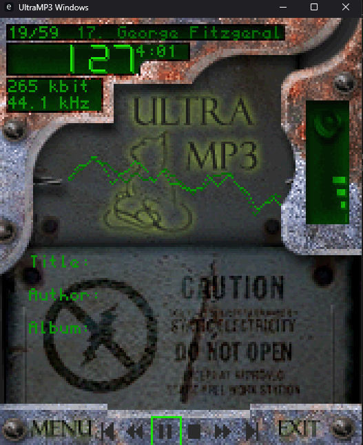

# UltraMP3 Windows x64

## Pratinjau aplikasi

| Skin Technic | Skin &lt;DEFAULT&gt; |
|---|---|
|  |  |

Port parsial UltraMP3 1.52 berdasarkan kode ARM dan aset yang dipulihkan dari SIS. Instalasi baru mulai dengan tema <DEFAULT> dari SIS. Tema Default HD dengan tekstur 4K dan Orbit bertema luar angkasa tersedia di Menu > Skin. Pilih Skin beberapa kali sampai Orbit tampil. Tekan F11 untuk layar penuh.

Ekstrak ZIP dan jalankan `UltraMP3-Windows.exe`. **Ctrl+O** menambah audio. **Tab** membuka playlist, panah atas/bawah memilih lagu, **F2** memberi atau melepas tanda, dan **Enter** membuka menu FILE. Klik dua kali untuk langsung memutar. Klik kanan pada lagu untuk menu FILE, termasuk Move yang mengurutkan lagu dengan panah. Klik **Menu** di bawah playlist untuk Rescan, Sort, Rename, Move atau Copy file, serta impor dan ekspor `playlist.ini`. **Remove from playlist** hanya menghapus entri.

Klik atau seret indikator volume di kanan. Bagian atas menaikkan volume hingga 100%, dan bagian bawah membisukan audio.

Playlist dipulihkan dari `%LOCALAPPDATA%\UltraMP3Windows\playlist.ini` dan pengaturan dari `windows.ini` di direktori yang sama. Playlist memakai UTF-16LE, indeks lagu, dan tanda yang sesuai dengan format Symbian. Path ke musik di drive Symbian perlu disesuaikan untuk Windows. Daftar yang dipulihkan menunggu Play.

Menu pemutar menyediakan play mode, repeat, visualization, skin, time display, play minimized, idle timeout, dan about. Visualisasi mendukung Oscilloscope, Spectrum Bars, dan None. Idle Timeout adalah opsi yang meminimalkan jendela Windows setelah periode tanpa interaksi.

Audio memakai WASAPI. MP3 dan WAV didekode langsung. S3M, MOD, XM dan IT memakai libopenmpt yang disertakan. Simpan DLL di samping EXE. Dua demo ada di folder `Demo`.

Build dari sumber dengan `cargo build --release --locked`. Tema Default HD bersifat opsional: build standar tidak memerlukan `assets/default-hd`, sehingga tetap berhasil walau aset itu tidak ada. Untuk menyertakan skin Default HD dan font 4K-nya, jalankan `cargo build --release --locked --features hd` dengan folder `assets/default-hd` tersedia. Lihat `E32-NOTES.md` untuk bukti dan batas port. Penghapusan fisik, operasi massal pada tanda, file manager lengkap, pemasangan skin eksternal, seek per pola tracker, dan kesetaraan runtime Symbian masih terbuka.


## Versi web

Buka `release/UltraMP3-Web` lewat server HTTP lokal.

```powershell
python -m http.server 8765 --bind 127.0.0.1 --directory release/UltraMP3-Web
```

Buka http://127.0.0.1:8765. Orbit dipilih saat pertama kali dibuka. Klik **Putar demo** atau pilih file MP3/WAV lewat **Buka audio**. Browser menyimpan pengaturan pemutar. File lokal dan antrean berlaku selama halaman terbuka. Format tracker dan operasi filesystem desktop masih tersedia di build Windows.

Untuk build ulang di Windows, pasang target `wasm32-unknown-unknown` dan CLI `wasm-bindgen` versi yang sama dengan `Cargo.lock`.

```powershell
rustup target add wasm32-unknown-unknown
cargo install --locked wasm-bindgen-cli --version 0.2.129
./web/build.ps1
```
